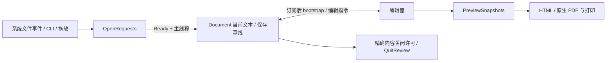

# MacDownPlus：启动与文档生命周期设计

## 1. 决策表

| ID | 事实/问题 | 选定处理 | 依据 |
|---|---|---|---|
| A1 | macOS Opened 可先于 Tauri Ready/setup | 初始化前注册 OpenRequests，所有打开入口汇入；Ready 后转主线程消费 | 原安装版 open -n -a 稳定复现 state() called before manage() |
| A2 | dirty 在前后端重复存储，关闭许可不对应保存内容 | Rust 文档聚合只保留当前文本与保存基线，派生 dirty；关闭许可绑定精确文本 | 保存 pending 时输入可复现 closeApproved=true 且仍 dirty |
| A3 | 退出只捕获一次窗口队列 | QuitReview 每轮比较全部文档与已批准文本；新增/修改需再确认 | 多窗口退出在已批准窗口继续输入没有原有兜底 |
| A4 | snapshot 单 resolver 被并发请求覆盖 | PreviewSnapshots 持有每代预览的 readiness 和共享一次中的快照 Promise；完成、超时、换代都有终态 | 两次 Copy HTML 首个 Promise 原先永久 pending |
| A5 | 全局菜单依赖文档窗口 | 应用级动作单独处理，Editor/Preferences 共用 | Preferences 焦点下 About/Help 无消费者 |
| A6 | 打印中间文件无清理 | 原生窗口任务销毁、构建失败、下次启动统一清理本应用创建的文件 | 原结束回调仅销毁窗口 |
| A7 | 初始化函数包在长 Builder 闭包里 | setup_app 单独函数；原有窗口/API 对接留在入口 | 便于审查 Ready 与状态创建顺序，不增加中间服务 |

## 2. 契约边界

- OpenRequests 在 Builder.manage 时存在；AppState 在 setup 中创建；Ready 后才读取文档状态。
- 文档保存失败不推进保存基线；保存时继续输入会保持 dirty。
- 关闭指令携带 approvedText，Rust 校验和当前文本相等后才移除文档与草稿。
- 退出审批每轮读取所有窗口，不丢弃新窗口和再次编辑的内容；Cancel 撤销整个退出流程。
- stdin 内容先落草稿再移除输入临时文件；Revert 在后端清理旧草稿。
- 前端先订阅 document-changed 再读取 bootstrap；加载文档不作为用户编辑重新持久化。
- 每代预览拥有自己的 token 与快照状态；并发调用共享结果，换代拒绝旧请求。
- 原有 Bundle Identifier 保持稳定，避免改名重置用户配置；应用、仓库、目录、CLI 名称改为 MacDownPlus/macdownplus。

## 3. 数据流

## 4. 复杂度预算

- 新增抽象层：0；新增的是平级职责模块，不串接 Coordinator/Service/Adapter。
- 新增同步原语：1 个 Mutex，仅负责初始化前跨线程文件入口的暂存；不能复用 AppState.docs，因为原崩溃时 AppState 尚不存在。
- 新增生产事件域：0；沿用 document-changed、menu-action 和现有偏好/打印事件。
- 新增副作用边：2（Ready 消费暂存打开请求、Preferences 消费已有 menu-action）；Destroyed 清理复用既有窗口回调，不新建观察者。
- 新增异步边：1（文件入口统一转到主线程）；不增加后台 worker/调度服务。
- 新增反向通知：0；新增生产触发 API：0。独立环境变量下的只读测试探针不属于产品入口。
- 现有 AppState 有 5 个 Mutex；启动暂存新增 1 个，由于状态尚不存在不能合并进 docs 锁。文档变更监听仍是每窗口 1 个，只调整到 bootstrap 之前。
- 本轮不宣称毫秒级性能收益；可量化收益是原版必现的冷启动失败及数据丢失时序，变为相应用例通过。
- 取消重复 dirty 字段；退出审批用已有文本作版本凭据，不增加 revision 计数器。
- 快照模块复用现有渲染 token，不另建请求 ID；共享进行中的 Promise。
- 测试探针由独立环境变量启用，只读验证真实文档；常规产品运行不启用。

## 5. 验收

- 原冷启动用例先失败，修复后中文/空格路径 cold + warm 均通过。
- 实际用户文档只读测试，内容 SHA-256 不变，不将正文写入报告。
- Rust 启动队列、关闭许可、退出再审批测试；既有 Markdown/保存保护测试。
- 页面重叠复制、保存期间编辑、偏好窗口全局菜单回归。
- 原生草稿恢复、插件、7 页 A4 PDF、正文末尾与打印临时文件清理。
- 有效 ad-hoc 签名的 app/DMG；M4 硬件和全部旧版系统仍不虚报实测。

## 6. 不做

不改写第三方渲染引擎；不以目录拆分替代行为验证；不为未来需求增加通用服务层。

## 原生插件与签名复验

完整签名后，实际原生自检发现不同 Team ID 的 bundle 被 Hardened Runtime Library Validation 拒绝，系统日志含明确 dyld 原因。保留 Hardened Runtime，为用户明确选择的原生插件能力添加 disable-library-validation entitlement；不关闭其他运行时防护。应用仍是本地 ad-hoc 签名，无 Apple 公证。
